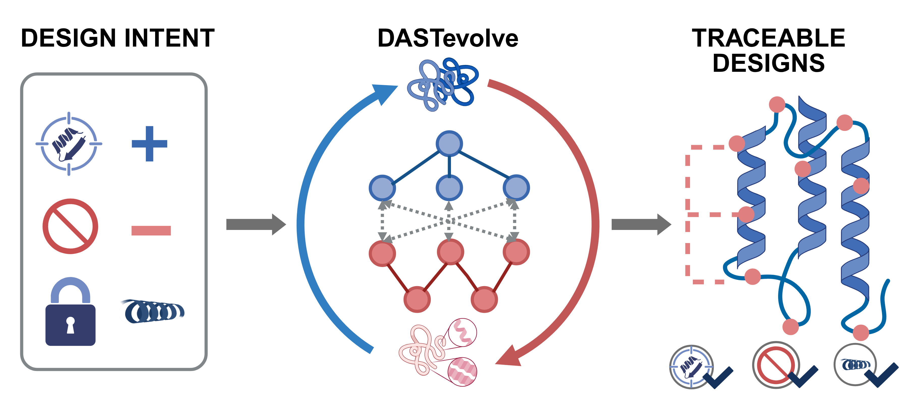

<h1 align="center">DASTevolve: Evolving Executable Programs for Protein Engineering</h1>

<p align="center">
  
</p>

DASTevolve is a Dual Abstract Syntax Tree (Dual-AST) protein-design framework with an LLM-guided outer loop and a MCTS inner search loop.
This repository contains a teaching demo, case studies, and a practical guide for configuring a new case.

## Run a packaged case

Use Linux, Python 3.12 with `venv`, Git, curl, an NVIDIA GPU with a CUDA 12.8-compatible driver, and credentials for an OpenAI-compatible endpoint. The launch command installs the required Python environments, downloads the selected models, checks their SHA-256 hashes and stages the case inputs. Set the three LLM variables in your shell or in a local environment file sourced via `DASTEVOLVE_ENV_FILE`. Keep your API key private.

```bash
git clone https://github.com/YiyangZHA0/DASTevolve.git
cd DASTevolve
export ASTEVOLVE_BOOTSTRAP_PYTHON=python3.12
export ASTEVOLVE_RUNTIME_ROOT="$HOME/dastevolve-runtime"
export ASTEVOLVE_LLM_API_BASE="https://your-endpoint.example/v1"
export ASTEVOLVE_LLM_MODEL="your-model"
read -rsp "LLM API key: " ASTEVOLVE_LLM_API_KEY && echo
export ASTEVOLVE_LLM_API_KEY
bash scripts/quickstart.sh asyn
```

| Case | Structure model | Included inputs |
|---|---|---|
| `asyn` | Classic ESMFold v1 | Residue evidence catalog |
| `tiam1` | Classic ESMFold v1 and Protenix Mini-ESM | Residue evidence catalog. The run creates a fresh GPU reference for its preflight check. |
| `cab` | Protenix v2 | Frozen paired/unpaired alignments and VHH reference features. [Sources and attribution](cases/cab_lys3_hewl_cdr_recovery/INPUTS.md) |
| `ttgr` | Protenix Mini-ESM | Packaged apo and naltrexone-bound state definitions. This case measures a computational pocket proxy. |

For `cab`, supply the exact Protenix-v2 checkpoint if your official download is unavailable. Put it at `${ASTEVOLVE_RUNTIME_ROOT}/models/protenix/checkpoint/protenix-v2.pt` or set `ASTEVOLVE_PROTENIX_V2_URL` to a URL you are authorized to use. The installer verifies the checkpoint against its pinned SHA-256. Upstream provides separate terms for these weights. [Protenix model terms](https://github.com/bytedance/Protenix#license)

The default example evaluates the seed program, then two accepted LLM revisions with a 10-round inner budget each. A revision begins with its predecessor's selected sequences and program. Rejected proposals consume attempt slots. The command exits unsuccessfully if it reaches the proposal limit before completing the requested revisions. The case's own feasibility gates determine scientific success.

```bash
bash scripts/quickstart.sh cab --plan          # Paths and budget, no downloads
bash scripts/quickstart.sh cab --prepare-only  # Install and download before requesting a GPU
bash scripts/quickstart.sh cab --prepared      # Reuse those packages and verify cached weights
```

On Slurm, run the last command inside a single-GPU allocation. On a multi-GPU machine, use `CUDA_VISIBLE_DEVICES` to give each case its own GPU. Each run creates a new directory under `${ASTEVOLVE_RUNTIME_ROOT}/runs`. Its `outer/verified-rounds.json` records the accepted program IDs, starting and selected sequence hashes, inner-budget counts and scientific gate outcomes. Use `--output /path/to/new-directory` to choose the destination. Model files, logs, generated structures and checkpoints stay outside the checkout. Model weights are fetched from their respective publishers or identified mirrors under their own terms. The exact files and checksums are recorded in [the model manifest](configs/case_models.json).

## Requirements

- Linux
- Mamba (the environment file is also Conda-compatible)
- An NVIDIA CUDA-capable GPU with a driver compatible with CUDA 12.8 for
  GPU-backed model execution
- An OpenAI-compatible LLM endpoint
- External model installations required by the selected case

The environment file installs Python 3.12 and the official PyTorch 2.9.1
CUDA 12.8 wheel.

The installation and dry-run checks do not execute an LLM, sequence model, or
structure model. A GPU is required only when a configured case invokes a
GPU-backed model.

## Install with Mamba

```bash
git clone https://github.com/YiyangZHA0/DASTevolve.git
cd DASTevolve
mamba env create -f environment.yml
mamba activate DASTevolve
cp configs/env.example .env.local
```

To update an existing `DASTevolve` environment after pulling code changes:

```bash
mamba env update -n DASTevolve -f environment.yml
mamba activate DASTevolve
```

Configure the LLM in `.env.local`:

```bash
export ASTEVOLVE_LLM_API_BASE="https://your-endpoint.example/v1"
export ASTEVOLVE_LLM_API_KEY="your-key"
export ASTEVOLVE_LLM_MODEL="your-model"
```

Configure shared external roots in `.env.local`. Keep model weights, tools,
datasets, credentials, temporary files, and run outputs outside the repository.
`configs/env.example` is the complete configuration reference; enable only the
backends required by the selected case.

```bash
export ASTEVOLVE_PROJECT_ROOT="${PWD}"
export ASTEVOLVE_RUNTIME_ROOT="${ASTEVOLVE_PROJECT_ROOT}/../DASTevolve_runtime"
export ASTEVOLVE_DATA_ROOT="${ASTEVOLVE_RUNTIME_ROOT}/datasets"
export ASTEVOLVE_MODEL_ROOT="${ASTEVOLVE_RUNTIME_ROOT}/models"
export ASTEVOLVE_TOOL_ROOT="${ASTEVOLVE_RUNTIME_ROOT}/tools"
export ASTEVOLVE_ARTIFACT_ROOT="${ASTEVOLVE_RUNTIME_ROOT}/runs"
export ASTEVOLVE_RUN_ROOT="${ASTEVOLVE_ARTIFACT_ROOT}"
export ASTEVOLVE_TMP_ROOT="${ASTEVOLVE_RUNTIME_ROOT}/tmp"
```

## Validate installation

Verify dependency consistency, CUDA visibility, and the packaged cases:

```bash
python -m pip check
python -c "import torch; print(torch.__version__, torch.version.cuda, torch.cuda.is_available())"
bash scripts/check_install.sh
python scripts/check_mcts.py
python scripts/check_esmfold_evidence.py
bash scripts/run_case.sh tiam1 --iterations 2 --dry-run
```

For the lower-level launcher, provide the inputs listed in each `case.json` under
`required_assets`. The packaged quickstart stages its inputs. For other bundles,
place their inputs under `${ASTEVOLVE_DATA_ROOT}/<case_id>/` and run
`bash scripts/check_install.sh --all-cases` on Linux.

Run the teaching demo or the Tiam1 case for example used in our case studies:

```bash
bash scripts/run_case.sh demo --iterations 1
bash scripts/run_case.sh tiam1 --iterations 100
## bash scripts/run_case.sh asyn --iterations 100
## bash scripts/run_case.sh cab --iterations 100
```

Outputs are written outside the repository under
`${ASTEVOLVE_RUNTIME_ROOT}/runs` unless `--output PATH` is provided.

## How to create a new case

Copy `cases/demo_case/` to a new directory and update these files:

- `case.json`: set the case ID and the entry program, configuration, and
  evaluator paths.
- `case_sheet.json`: describe the scientific objective, success and failure
  signals, and hypotheses.
- `design_state.json`: define complete chain sequences, zero-based half-open
  mutable spans, fixed residues, the Functional AST, the Structural AST, and
  mapping edges.
- `initial_program.py`: define the LLM-editable Node and amino-acid policy and
  the locked GPU funnel.
- `*_evaluator.py`: define normalized metrics, weights, missing-data policies,
  and immutable hard gates.
- `memory.yaml`: provide read-only seed knowledge. Learned memory is written
  to the runtime output directory.
- `config.yaml`: configure the LLM, specialist islands, generation barrier,
  and memory policy.

Add an alias for the new directory in `scripts/run_case.sh`, then validate it:

```bash
python scripts/preview_case.py --manifest cases/your_case/case.json
python scripts/check_assets.py --manifest cases/your_case/case.json
python scripts/run_outer.py \
  --manifest cases/your_case/case.json \
  --iterations 2 \
  --output "${ASTEVOLVE_RUNTIME_ROOT}/runs/your_case_validation"
```

For a formal case that should meet the same readiness policy, also
declare `recorded_evidence_path` and `preflight` in `case.json`, then run:

```bash
python scripts/case_preflight.py run \
  --manifest cases/your_case/case.json \
  --report /tmp/your_case_preflight.json
python scripts/case_preflight.py verify \
  --manifest cases/your_case/case.json \
  --report /tmp/your_case_preflight.json
```

Use relative paths for case code and `data://<case_id>/...` for external
reference inputs. Inject model locations, databases,
licensed tools, and credentials through environment variables.

PyRosetta/Rosetta, getContacts, ESMFold2, and AlphaFold 3 remain optional
backends. Check their availability with:

```bash
python scripts/check_physics_backends.py
```

Users can add and configure their own backends as needed.

DASTevolve is distributed under [MIT](LICENSE); the adapted OpenEvolve
components retain the [Apache 2.0 license](LICENSES/Apache-2.0.txt).
